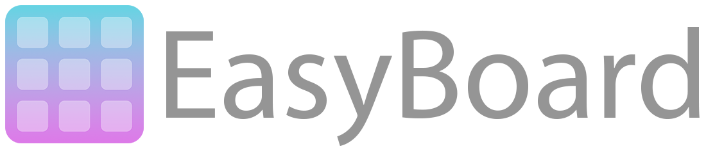
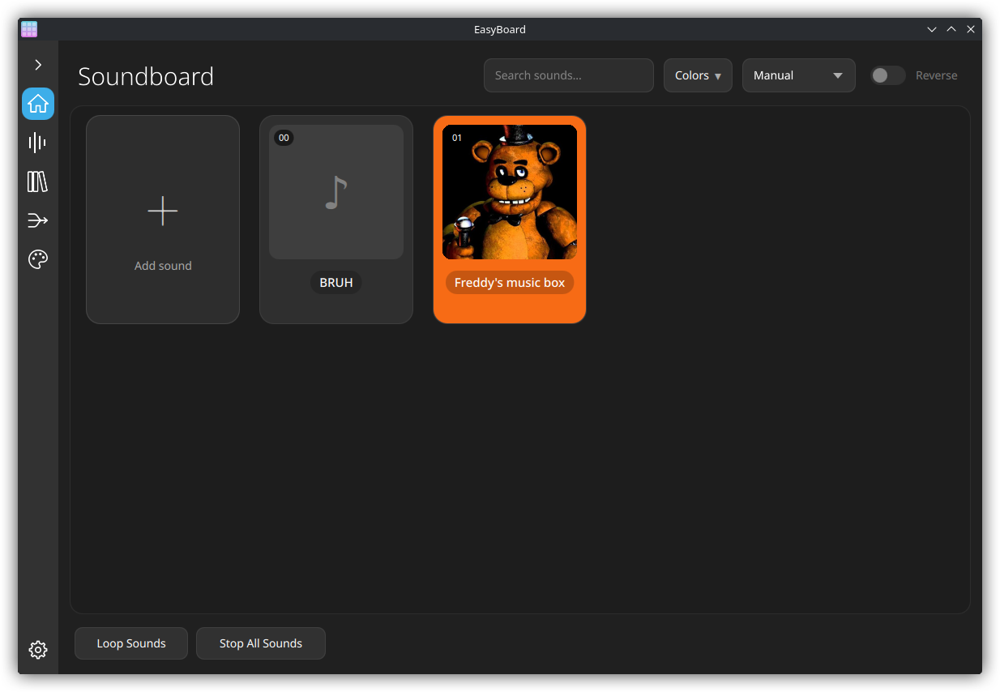
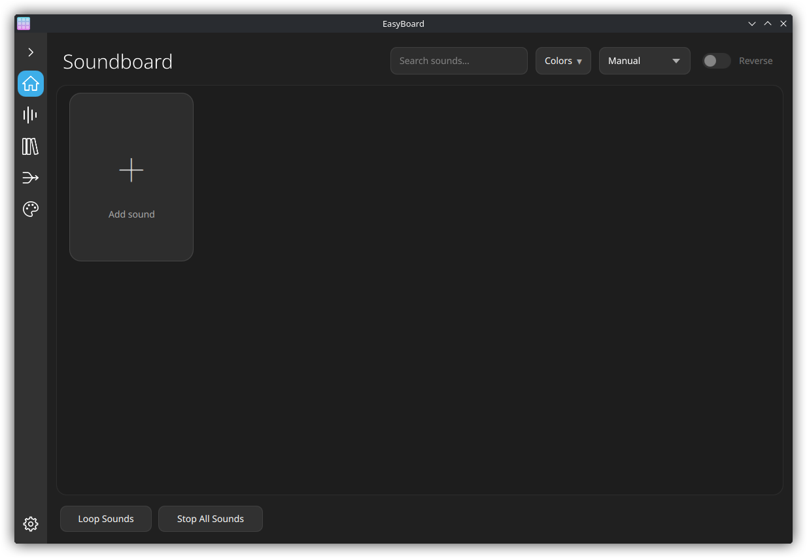
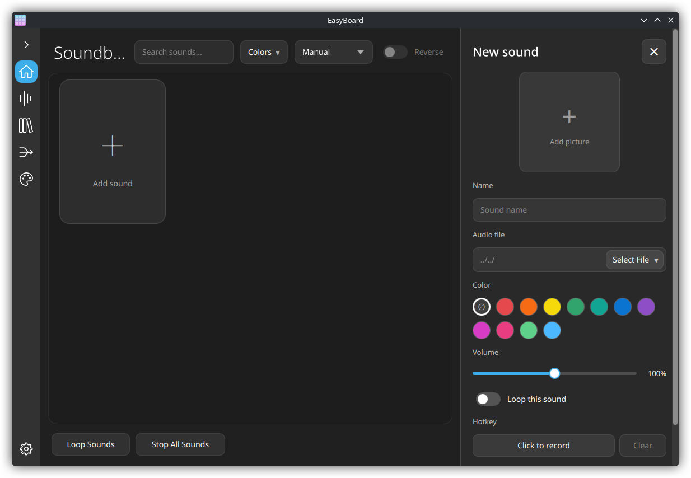
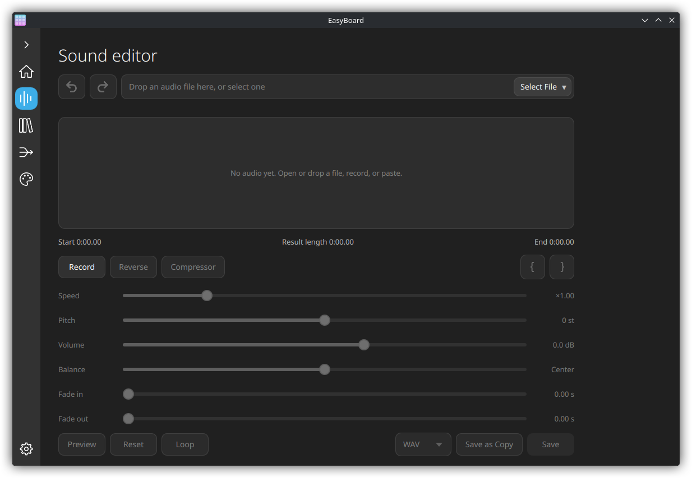
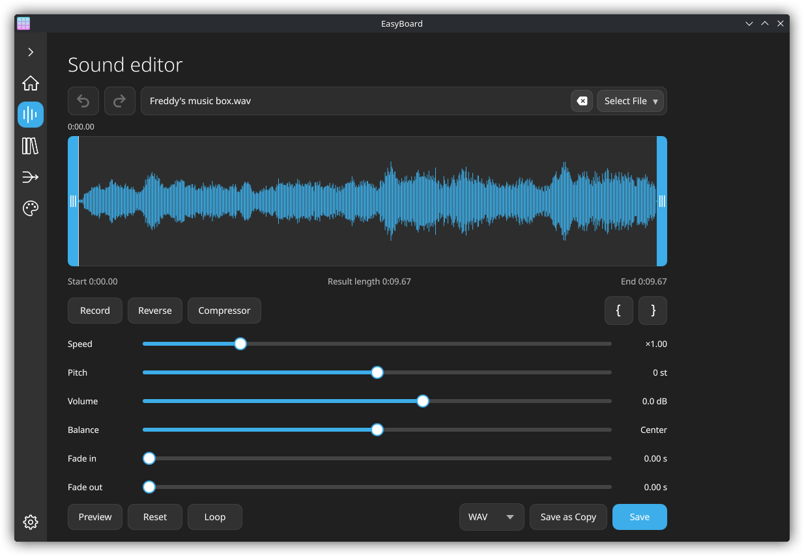
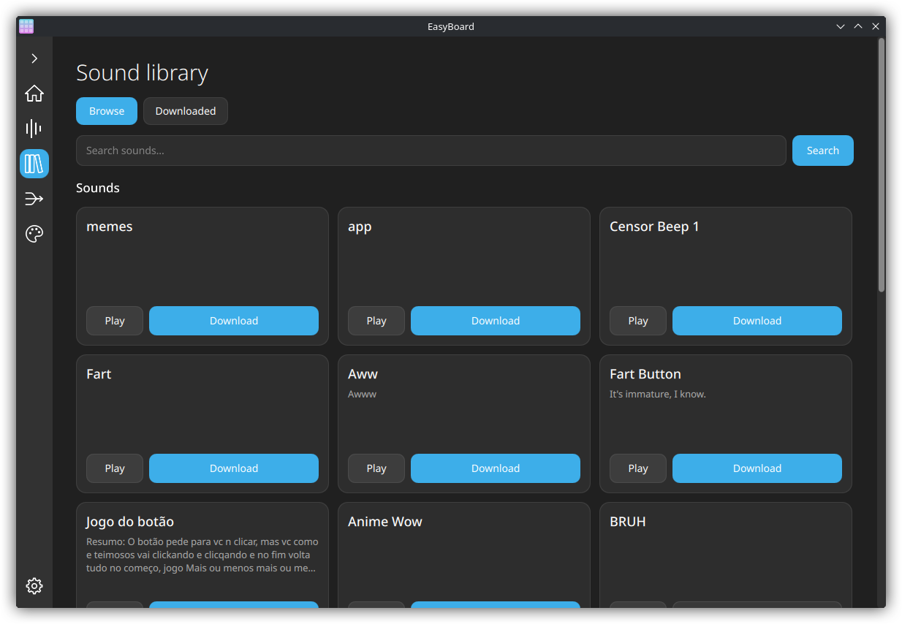
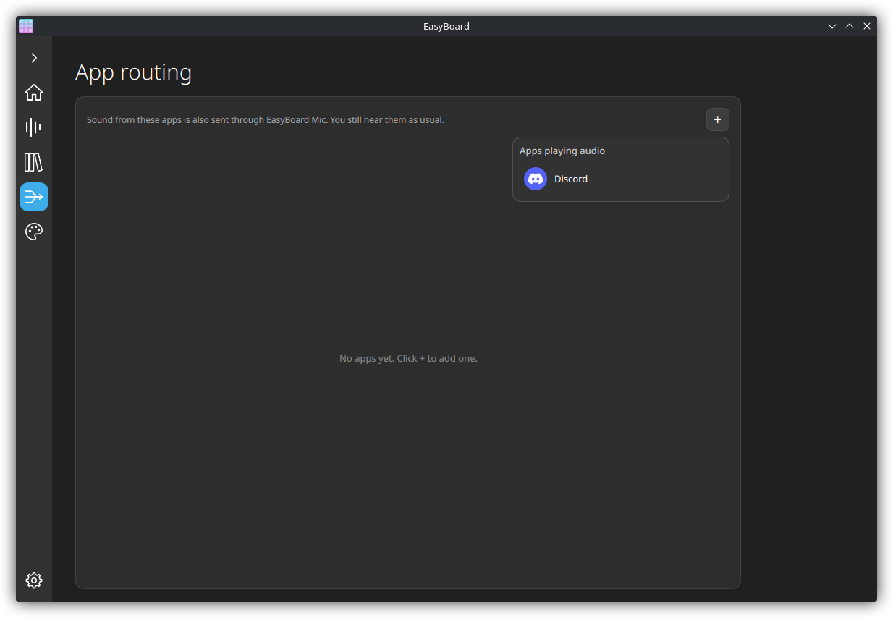
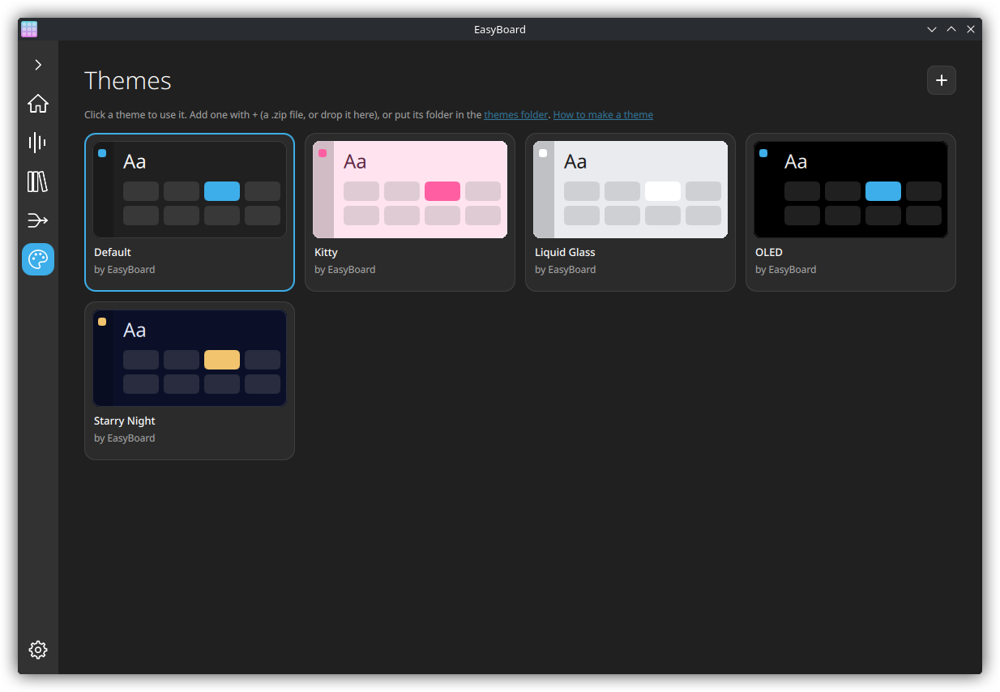
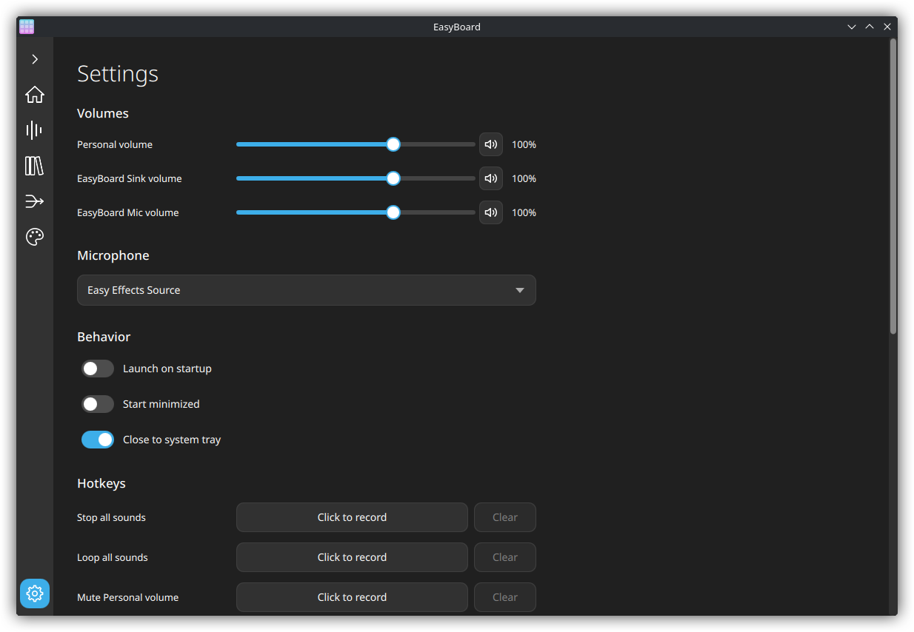

<div align="center">



<p>A cross-platform soundboard app written in Rust.<br>
Play sounds through your microphone in Discord, OBS, games and any other app.</p>

<p>
<a href="https://github.com/MrRedstonia/EasyBoard/releases/latest"><b>Download</b></a> ·
<a href="#installation">Installation</a> ·
<a href="#screenshots">Screenshots</a> ·
<a href="THEMES.md">Themes</a>
</p>



</div>

## Features

- **Soundboard**: tiles with names, pictures and colors, a global hotkey for every sound, and looping.
- **Sound editor**: record or open a sound, cut it, and add effects like speed, pitch and fades.
- **Sound library**: search and download sounds from myinstants.com.
- **App routing**: send the sound of other apps (music, videos, games) through your microphone.
- **Themes**: four built-in themes, your own picture as the background, or a theme you make yourself.
- **Separate volumes** for what you hear and what others hear.

## Installation

Download the latest version from the [Releases page](https://github.com/MrRedstonia/EasyBoard/releases/latest).

<details>
<summary><b>Linux</b></summary>
<br>

Pick the one that fits your distribution:

| Distribution | Download |
| --- | --- |
| Debian, Ubuntu | `easyboard_<version>_amd64.deb` |
| Fedora | `easyboard-<version>.x86_64.rpm` |
| Arch | From the AUR: `easyboard-app-bin`, or `easyboard-app` to build it yourself |
| Any other | `EasyBoard-<version>-x86_64.AppImage` (make it executable and run it), or `EasyBoard-<version>-linux-x86_64.tar.gz` (run `bin/easyboard`) |

No virtual cable is needed. EasyBoard adds two inputs of its own:

- **EasyBoard Sink**: only the soundboard.
- **EasyBoard Mic**: the soundboard and your microphone together.

Choose one of them as your microphone in Discord, OBS or any other app.
Needs PulseAudio or PipeWire (with `pipewire-pulse`).

> [!NOTE]
> Global hotkeys don't work on Wayland. Bind a shortcut to `easyboard -p 01` in your desktop's settings instead.

</details>

<details>
<summary><b>Windows</b></summary>
<br>

1. Install [VB-Cable](https://vb-audio.com/Cable/) (free) and restart your PC.
2. Download and run `EasyBoard-<version>-setup.exe`.
   If Windows SmartScreen shows a warning, click **More info**, then **Run anyway**.
3. Open EasyBoard. If it asks for a virtual cable, choose VB-Cable.
4. In Discord, OBS or any other app, choose **CABLE Output** as your microphone.

Needs Windows 10 or 11. App routing needs Windows 10 version 2004 or newer.

</details>

<details>
<summary><b>macOS</b></summary>
<br>

1. Install [VB-Cable](https://vb-audio.com/Cable/) (free).
2. Download `EasyBoard-<version>-macOS-universal.dmg` and drag EasyBoard into Applications.
   It runs on both Apple Silicon and Intel Macs.
3. The first time you open it, macOS may block it. Go to **System Settings → Privacy & Security** and click **Open Anyway**.
4. Open EasyBoard. If it asks for a virtual cable, choose VB-Cable.
5. In Discord, OBS or any other app, choose **VB-Cable** as your microphone.

Needs macOS 12 or newer. App routing needs macOS 14.2 or newer.

</details>

## Screenshots

<table>
  <tr>
    <td></td>
    <td></td>
  </tr>
  <tr>
    <td></td>
    <td></td>
  </tr>
  <tr>
    <td></td>
    <td></td>
  </tr>
  <tr>
    <td></td>
    <td></td>
  </tr>
</table>

## More

<details>
<summary><b>Command line</b></summary>
<br>

```
easyboard -n, --no-gui                             run in the tray without a window
easyboard -p, --play <id>                          play a sound by its ID (00, 01, ...)
easyboard -s, --stop                               stop all sounds
easyboard -l, --loop <on|off|toggle>               loop all sounds
easyboard -l, --loop <id> <on|off|toggle>          loop one sound
easyboard -v, --volume <personal|sink|mic>         show a volume
easyboard -v, --volume <personal|sink|mic> <50|+10|-10>
                                                   set, raise or lower a volume (in percent)
easyboard     --mute <personal|sink|mic> [on|off|toggle]
                                                   mute or unmute (toggles by default)
easyboard     --list [full] [sort=<key>]           list your sounds
easyboard -V, --version                            show the version
easyboard -h, --help                               show help
```

`personal` is what you hear, `sink` is the soundboard others hear, and `mic` is your microphone.
`sort` can be `id`, `name`, `length`, `color`, `added` or `manual`. Add `:desc` to reverse it, like `sort=name:desc`.
`full` also shows each sound's file, picture and color.

</details>

<details>
<summary><b>Build from source</b></summary>
<br>

You need Rust (stable), Qt 6.6 or newer and a C++17 compiler.
On Linux you also need `libpulse-dev` and `pactl` (from `pulseaudio-utils` or `pipewire-pulse`).

```
cargo build --release
```

Saving sounds as MP3, OGG, FLAC, Opus or M4A needs [FFmpeg](https://ffmpeg.org/).
The packaging scripts for each platform are in [`packaging/`](packaging).

</details>

## License

EasyBoard is released under the [MIT License](LICENSE). See [THIRD-PARTY.md](THIRD-PARTY.md) for the libraries it uses.
